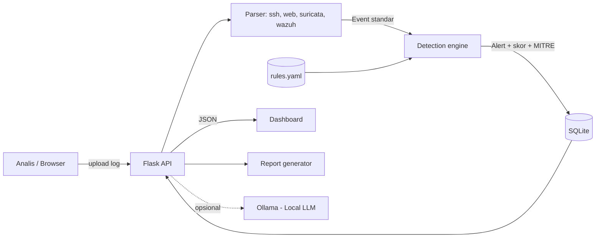
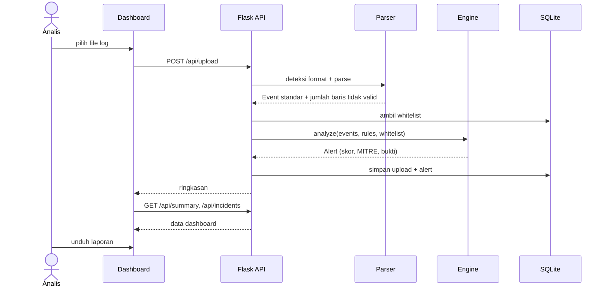

# SOC Alert Triage Dashboard

Tugas Proyek Ethical Hacking, Teknik Informatika Polines (Dosen Industri: Rofiq Fauzi)
Tema No. 6: SOC / SIEM Alert Analyzer

> Lengkapi bagian bertanda **(ISI)** sebelum dikumpulkan: nama/NIM, screenshot, hasil aktual pengujian, link video.

## 1. Identitas Proyek

| Nama | NIM | Peran |
| --- | --- | --- |
| (ISI) | (ISI) | Backend dan engine |
| (ISI) | (ISI) | Frontend dan laporan |
| (ISI) | (ISI) | Lab, pengujian, dokumentasi |

**Latar belakang.** Analis SOC menerima ribuan alert mentah dari banyak sumber (log SSH, web server, IDS). Sebagian besar adalah noise, sehingga serangan yang nyata mudah terlewat. Aplikasi ini membantu **triase**: menormalkan log dari beberapa sumber, mendeteksi pola serangan, mengorelasikan alert dari IP yang sama, memberi skor prioritas, dan menyarankan langkah respons.

**Tujuan.** Menyediakan alat triase yang dapat dijelaskan (rule berbasis YAML, skor transparan) dan teruji.

**Ruang lingkup.** Analisis log offline yang diunggah (bukan monitoring real-time). Semua pengujian memakai log sintetis buatan sendiri dan/atau target latihan di lab terisolasi (DVWA, Juice Shop). Tidak ada pengujian ke sistem pihak lain.

## 2. Fitur Utama

1. **Ingest dan normalisasi.** Unggah satu atau banyak file sekaligus. Format dikenali otomatis: SSH `auth.log`, access log Nginx/Apache (combined), Suricata `eve.json`, dan alert Wazuh. Semua diubah ke format event standar.
2. **Triase dan korelasi.** Sembilan rule (lihat bagian 4) dengan severity, pemetaan MITRE ATT&CK, dan skor prioritas. IP yang memicu beberapa rule dikorelasikan menjadi satu insiden, termasuk lintas sumber log.
3. **Dashboard dan laporan.** Strip severity, grafik alert per waktu, peringkat IP, tabel insiden dengan bukti dan rekomendasi, ekspor laporan (Markdown dan halaman cetak/PDF).

Tambahan: status alert (New, Investigating, True Positive, False Positive), whitelist IP, dan penjelasan insiden dengan Local LLM (opsional).

**Contoh kasus.** Analis mengunggah `auth.log`, `access.log`, dan `eve.json` dari server yang sama. Aplikasi menampilkan IP `203.0.113.45` sebagai insiden Critical teratas: brute force SSH yang berhasil login, lalu SQLi dan port scan dari IP yang sama, lengkap dengan bukti log dan rekomendasi (blokir IP, reset password, periksa aktivitas pasca login).

## 3. Arsitektur Sistem



| Komponen | Peran |
| --- | --- |
| Dashboard (HTML/CSS/JS murni) | Upload, grafik, tabel, filter, whitelist, laporan |
| Flask API (`app/routes.py`) | Endpoint, validasi input, header keamanan |
| Parser (`app/parsers/`) | Deteksi format dan normalisasi ke `Event` |
| Detection engine (`app/engine/`) | Menjalankan rule, korelasi, skor, pengelompokan insiden |
| SQLite (`app/db.py`) | Menyimpan hasil analisis, status alert, whitelist |
| Report generator (`app/reports.py`, `templates/report.html`) | Laporan Markdown dan halaman cetak |
| LLM (`app/llm.py`) | Opsional, hanya jika `LLM_ENABLED=true` |

Catatan desain: yang disimpan di database adalah **alert beserta bukti** (maksimal 5 baris log per alert), bukan seluruh event, agar database kecil.

## 4. Desain dan Cara Kerja



### Rule deteksi (`app/rules/rules.yaml`)

| ID | Deteksi | Logika | Severity | ATT&CK |
| --- | --- | --- | --- | --- |
| R01 | Brute force SSH | 10 atau lebih login gagal dari 1 IP dalam 300 detik | High | T1110 |
| R02 | Brute force berhasil | Login sukses setelah 10 atau lebih kegagalan dalam 300 detik | Critical | T1110, T1078 |
| R03 | SQL Injection | Pola `UNION SELECT`, `' OR x=y`, `OR 1=1`, `sleep()`, `DROP TABLE`, dll (setelah URL-decode 2x) | High | T1190 |
| R04 | XSS | `<script`, `onerror=`, `javascript:` | Medium | T1190 |
| R05 | Path traversal | `../`, `..\`, `/etc/passwd` | High | T1190 |
| R06 | Port scan | 15 atau lebih port tujuan berbeda dari 1 IP dalam 60 detik | Medium | T1046 |
| R07 | Tools scanner | User-agent sqlmap, nikto, nmap, dll | Medium | T1595 |
| R08 | Serangan multi-tahap | 1 IP memicu 3 atau lebih rule berbeda | Critical | gabungan |
| R09 | Alert bawaan sensor | Alert Suricata/Wazuh diteruskan, severity dipetakan dari sensor | Low-Critical | dari sensor |

### Skor prioritas

`skor = bobot severity + bonus volume + bonus korelasi`

- Bobot: Low 1, Medium 3, High 5, Critical 8
- Bonus volume: +1 per 10 kejadian, maksimal +3
- Bonus korelasi: +2 bila IP yang sama memicu 2 rule berbeda atau lebih

Insiden = kumpulan alert dari satu IP; severity insiden = severity tertinggi, skor insiden = skor alert tertinggi.

## 5. Stack Teknologi dan Alasan

| Teknologi | Alasan |
| --- | --- |
| Python 3.12 + Flask | Ringan, mudah dijelaskan saat demo, cocok untuk tools keamanan |
| PyYAML | Rule disimpan sebagai data sehingga bisa diubah tanpa mengubah kode |
| SQLite | Tanpa server tambahan, cukup untuk skala lab |
| HTML/CSS/JS murni | Tanpa dependensi CDN, bisa berjalan offline di lab |
| Docker Compose | Dosen dapat menjalankan dengan satu perintah |
| Ollama (opsional) | Local LLM offline, tanpa biaya dan tanpa mengirim data ke cloud |

**Penggunaan AI.** (ISI salah satu)
- *Tidak menggunakan AI.* (hapus bagian lain), atau
- Model Local LLM: `qwen2.5:3b` (tag Ollama), kebutuhan minimum sekitar 4 GB RAM, dijalankan dengan `docker compose --profile llm up -d` lalu `docker compose exec ollama ollama pull qwen2.5:3b`. Peran AI hanya menjelaskan insiden; deteksi sepenuhnya berbasis rule. Tuliskan juga tools AI yang dipakai saat pengembangan, bila ada.

## 6. Instalasi dan Menjalankan

### Dengan Docker (disarankan)

```bash
cp .env.example .env
docker compose up --build
# buka http://localhost:8000
```

### Tanpa Docker

```bash
python -m venv .venv && source .venv/bin/activate    # Windows: .venv\Scripts\activate
pip install -r requirements.txt
LOG_YEAR=2026 flask --app app run --port 8000         # PowerShell: $env:LOG_YEAR=2026; flask --app app run --port 8000
```

`LOG_YEAR` dipakai karena `auth.log` klasik tidak menyimpan tahun. Log contoh dibuat ulang dengan `python tools/generate_logs.py`.

### Cara memakai

1. Buka dashboard, pilih **Coba skenario uji** lalu **Jalankan skenario** (atau unggah log sendiri).
2. Lihat strip severity dan daftar insiden; klik baris insiden untuk bukti dan rekomendasi.
3. Ubah status alert di tab **Semua alert**, tambahkan IP tepercaya di tab **Whitelist IP**.
4. Unduh laporan lewat **Unduh laporan (.md)** atau **Laporan cetak** (Ctrl+P untuk PDF).

### Pengujian otomatis

```bash
python -m unittest discover -s tests -v     # atau: pytest
```

## 7. Screenshot

(ISI: screenshot asli aplikasi yang berjalan. Simpan di `docs/` dan tampilkan dengan keterangan.)

| Gambar | Keterangan |
| --- | --- |
| `docs/01-dashboard.png` | Halaman utama dengan strip severity dan insiden |
| `docs/02-detail-insiden.png` | Detail insiden: bukti log dan rekomendasi |
| `docs/03-pengujian.png` | Output pengujian (`unittest`) |
| `docs/04-laporan.png` | Laporan insiden |

## 8. Skenario Pengujian

Data uji ada di `sample_logs/` dan dapat dijalankan dari dropdown skenario di dashboard. Pengujian otomatis ada di `tests/test_scenarios.py`.

| No. | Skenario | Input | Hasil yang diharapkan | Hasil aktual | Bukti |
| --- | --- | --- | --- | --- | --- |
| 1 | SSH brute force berhasil | `auth_bruteforce.log` | R01 dan R02 untuk 203.0.113.45, Critical, T1110/T1078, insiden teratas | (ISI) | (ISI) |
| 2 | Serangan web | `web_attacks.log` | R03, R04, R05, R07 untuk 203.0.113.45; 198.51.100.77 hanya R04 | (ISI) | (ISI) |
| 3 | Trafik normal | `normal_auth.log` + `normal_web.log` | 0 alert, termasuk URL sah yang mirip serangan dan salah ketik password 2x | (ISI) | (ISI) |
| 4 | Korelasi lintas sumber | `auth_bruteforce.log` + `web_attacks.log` + `suricata_scan.json` | R06 dan R08 muncul untuk 203.0.113.45, semua alertnya terkorelasi | (ISI) | (ISI) |
| 5 | Log rusak | `corrupted.log` | Tidak crash, baris tidak valid dihitung, baris valid tetap dianalisis | (ISI) | (ISI) |

Isi kolom hasil aktual dan bukti dengan hasil serta screenshot dari mesin Anda sendiri.

**Pengujian dengan target lab (nilai tambah, opsional).** Jalankan DVWA atau Juice Shop di VM/Docker lokal, kirim payload dari mesin sendiri (mis. sqlmap), ambil access log-nya, lalu unggah ke aplikasi. Hanya lakukan di lingkungan lab milik sendiri.

## 9. Keterbatasan, Keamanan, dan Etika

**Keterbatasan dan false positive/negative yang diketahui**
- Deteksi berbasis pola regex: payload yang disamarkan (obfuscation lanjutan, encoding di luar URL-encoding) dapat lolos (false negative).
- Pencarian sah yang berisi teks seperti `' or x=y` dapat memicu R03 (false positive). Gunakan whitelist atau ubah pola di `rules.yaml`.
- R06 mengandalkan event flow/alert yang memiliki port tujuan (mis. dari Suricata); log SSH/web saja tidak cukup untuk deteksi port scan.
- Zona waktu pada log diabaikan agar semua sumber sebanding; log dari zona waktu berbeda perlu diseragamkan lebih dulu.
- `auth.log` tanpa tahun memakai `LOG_YEAR`; log yang melewati pergantian tahun tidak ditangani.
- Whitelist hanya berlaku untuk analisis berikutnya, tidak mengubah hasil lama (event tidak disimpan).
- Bukan monitoring real-time; analisis batch atas file yang diunggah.

**Keamanan aplikasi**
- Semua query SQL berparameter; input severity/status/IP divalidasi.
- Isi log (kontrol penyerang) hanya ditampilkan lewat `textContent` / auto-escape Jinja, sehingga tidak bisa menjadi XSS di dashboard.
- Batas ukuran upload (`MAX_UPLOAD_MB`), batas panjang field yang dicocokkan regex (mencegah regex lambat), file tidak disimpan ke disk.
- Header keamanan: CSP, `X-Content-Type-Options`, `X-Frame-Options`, `Referrer-Policy`.
- LLM hanya menerima data terstruktur hasil deteksi, bukan isi log mentah, untuk mencegah *prompt injection* dari log.
- Aplikasi **tidak memiliki autentikasi** karena ditujukan untuk lingkungan lab lokal; jangan diekspos ke internet.

**Etika.** Semua data uji sintetis atau dari lab terisolasi milik sendiri. Aplikasi hanya menganalisis log, tidak melakukan scanning atau eksploitasi.

## 10. Video Demo

(ISI: link YouTube 3-5 menit, status Public/Unlisted)

---

## Struktur Repository

```
app/                 Aplikasi Flask (routes, db, llm, reports)
  parsers/           ssh.py, web.py, suricata.py, wazuh.py
  engine/            rules.py, scoring.py, incidents.py
  rules/rules.yaml   Aturan deteksi
  static/            Dashboard (index.html, app.css, app.js)
  templates/         Template laporan cetak
sample_logs/         Log sintetis untuk skenario uji
tests/               Pengujian otomatis
tools/generate_logs.py  Pembuat log sintetis
Dockerfile, docker-compose.yml, requirements.txt, .env.example
```
